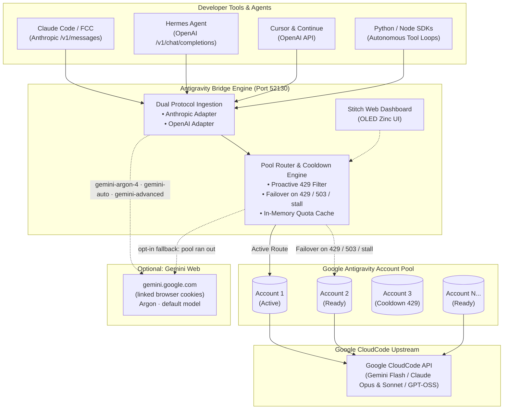

<div align="center">

# ⚡ Antigravity Bridge

### Universal Multi-Account AI Gateway & Proxy for Google Antigravity (CloudCode)

**Zero-downtime, auto-failover quota pool and dual-protocol gateway (Anthropic & OpenAI) for Claude Code, Hermes Agent, Cursor, Continue, and Custom Agentic Loops.**

[](https://opensource.org/licenses/ISC)
[](https://nodejs.org/)
[](https://docs.anthropic.com/)
[](https://stitch.withgoogle.com/)

[**Features**](#-features) • [**Quick Start**](#-quick-start) • [**Gemini Web**](#-gemini-web-argon) • [**Client Guides**](#-client-integration-guides) • [**Web Dashboard**](#-web-dashboard) • [**API Docs**](#-api-reference) • [**CLI Reference**](#-cli-commands)

---

</div>

## 📌 Overview

**Antigravity Bridge** transforms multiple personal or team Google accounts into a single, high-availability, unified AI inference endpoint. 

When developing with advanced coding agents like **Claude Code**, **Hermes**, or **Cursor**, hitting Google CloudCode's rate limits (`HTTP 429 RESOURCE_EXHAUSTED` / *"Individual quota reached"*) halts your momentum. Antigravity Bridge solves this by pooling multiple Google accounts and providing **automatic, transparent failover**. If your active account hits a rate limit, or Google has no capacity for the model on it, the bridge routes the request to the next available account in the pool before anything is streamed back, so your session and tool loop carry on.

An optional second backend, **Gemini Web**, reaches models that are only in the Gemini app (such as **Argon**, `gemini-argon-4`) by using a signed-in browser session's cookies. See [Gemini Web (Argon)](#-gemini-web-argon).



---

## ✨ Features

- 🔄 **Unified Multi-Account Quota Pool**: Combine 2, 6, or 20+ Google accounts into a single virtual pool.
- ⚡ **Transparent Auto-Failover**: When an account reaches its quota limit (HTTP 429), the request is retried on the next available account and the exhausted one cools down until Google's reset time. A 503 "no capacity" rotates too, without a cooldown, since capacity is per project and not a quota signal. Failover happens before the response starts streaming; a failure after the first chunk reaches the client as an error event.
- ⏱ **Stall Rotation**: Google occasionally accepts a request and then never answers, in bursts of several minutes on one account. After `BRIDGE_UPSTREAM_TIMEOUT_MS` (60 s) the bridge moves on to another account instead of waiting inside the burst, and rests the stalled one for `BRIDGE_STALL_REST_SECONDS` (300 s). It is not a quota cooldown, so nothing is written to the quota file.
- 🌐 **Patient Connections**: each of Google's addresses gets `BRIDGE_CONNECT_ATTEMPT_TIMEOUT_MS` (2 s) to connect instead of Node's 250 ms, and a connection that fails quickly is retried after 2 s and then 5 s, so a few seconds of network trouble on the host no longer fail the request.
- ⏱️ **Dual Rolling Quota Telemetry**: Live extraction and monitoring of Google's internal **5-Hour Rolling Limit %** and **Weekly Cycle Cap %** per account.
- 🔌 **Dual-Protocol Translation**:
  - **Anthropic Messages API** (`/v1/messages`): Full streaming SSE, extended thinking blocks (`claude-opus-4-6-thinking`), and multi-turn tool calling.
  - **OpenAI Chat Completions** (`/v1/chat/completions`): Full streaming, `tool_calls` schemas, `reasoning_effort` mapping, and function execution.
- 🌐 **Gemini Web models (optional)**: link a browser session's cookies to an account and use `gemini-argon-4` (Argon), `gemini-auto` and `gemini-advanced` from the same endpoints, tool calling included. A separate quota from CloudCode; see [Gemini Web (Argon)](#-gemini-web-argon).
- 🩹 **JSON & tool-call repair**: non-streaming `response_format` JSON answers from CloudCode models, and Gemini Web's prompted tool calls, are repaired before they reach the client (code fences, trailing commas, comments, single quotes, unclosed brackets), so one malformed character does not break an agent's loop. Repair cannot recover a reply that was cut off: on CloudCode a tool call the output cap cuts off never arrives (see [Controlling reasoning](#controlling-reasoning)), and a JSON answer cut at `max_tokens` comes back closed but incomplete, so check for `finish_reason: "length"`.
- 📊 **Usage by model**: the bridge counts requests and tokens per model (`npm run bridge:usage`, `/api/usage`, and a ledger on the dashboard), with Gemini Web counts marked as estimates on the dashboard.
- 🎨 **Google Stitch Web Dashboard**: High-craft web interface built to Google Stitch specifications (`DESIGN.md`) in **Minimalist OLED Zinc** dark mode, with smooth live countdown timers, activity streams, and an interactive theme switcher.
- 🔑 **Automated PKCE OAuth & Background Refresh**: One-click Google login via web browser, or push an existing refresh token from the dashboard or `/api/accounts/push`. Tokens refresh automatically in the background before expiration.
- 🖥️ **macOS LaunchAgent Support**: Native background daemon running automatically on system startup.

---

## 🧠 Supported Models

CloudCode model ids are **Google's own ids, sent verbatim** — what you configure is exactly what runs
(the [Gemini Web](#-gemini-web-argon) ids are the bridge's own names, and its opt-in fallback is the one
case where another model answers). Every
figure below comes from Google's `fetchAvailableModels`; re-check it any time with
`npm run bridge:models`, which reports anything that has drifted.

| Model ID | Thinking budget | Context | Output | Best suited for |
| :--- | :--- | :--- | :--- | :--- |
| `claude-opus-4-6-thinking` | 1,024 | 250K | 64K | Complex refactors, deep reasoning |
| `claude-sonnet-4-6` | 1,024 | 250K | 64K | High-speed agentic coding, daily pair-programming |
| `gemini-3.8-flash-tiered` | dynamic | 1M | 65K | **Newest and most capable Gemini — pick low/medium/high per request** |
| `gemini-3-flash` | dynamic | 1M | 65K | General fast generation |
| `gemini-3.5-flash-lite` | off unless asked | 1M | 65K | Ultra-low latency |
| `gemini-3.1-flash-lite` | off unless asked | 1M | 65K | Ultra-low latency, older generation |
| `gpt-oss-120b-medium` | 8,192 | 131K | 32K | GPT-OSS 120B via Antigravity |

**"dynamic"** means the model sizes its own reasoning. The bridge forwards that rather than pinning
a number, since an explicit budget would switch it off.

**"off unless asked"**: the Flash Lites can reason but declare no default budget, and without one they
do not. The bridge sends them no thinking settings unless you ask for reasoning — an explicit budget,
or an effort level above the protocol's default (`reasoning_effort: "high"`, or Anthropic's
`xhigh` / `max`).

**There is no Gemini Pro.** Google stopped serving `gemini-pro-agent` and `gemini-3.1-pro-low`
(HTTP 404), and `gemini-2.5-pro` answers 503 "no capacity" on every account. Pro ids resolve to
`gemini-3.8-flash-tiered`, with a warning in the bridge log.

**Tiered vs. fixed tiers.** Antigravity's own model picker maps its "flash" option to
`gemini-3.8-flash-tiered` and lets you slide reasoning from low to high — the tier is a *request
parameter*, not part of the model name. Use `reasoning_effort` (or `thinking.budget_tokens`) to
choose it. Google used to offer fixed-tier ids too (`gemini-3.6-flash-high`, `gemini-3.5-flash-low`,
and so on), with the tier in the name. It no longer serves any of them, so those ids now resolve to
the tiered model at the tier their name fixed: `-low` thinks 1,000 tokens, `-medium` 4,000, and `-high`
stays dynamic, as before. `reasoning_effort` scales from there, and an explicit budget overrides it.
A reasoning suffix on a model name works the same way, on any Gemini id: `gemini-3-flash-low` is
`gemini-3-flash` at the low tier, and `gemini-3.8-flash-tiered-medium` is the tiered model at medium. The
bridge warns that the id is not exact and keeps both the model and the tier. Claude and GPT-OSS ignore
the suffix, because their reasoning budgets are fixed.

### Controlling reasoning

Each model carries its own default budget, so the same request reasons differently per model.

- **Anthropic API**: `thinking: { budget_tokens: N }` sets an exact figure, or
  `thinking: { type: "disabled" }` turns reasoning off. Otherwise `output_config.effort` — which
  Claude Code sends on every request — scales that model's default: `low` is a quarter of it,
  `medium` a half, `high` **is it**, `xhigh` double, `max` four times. In Claude Code that is
  `/effort`, or `effortLevel` in its settings.
- **OpenAI API**: `reasoning_effort` scales the same default — `low` is a quarter of it,
  `medium` **is it**, `high` is four times it. `reasoning_tokens: N` sets an exact figure.
- **Tiered models** (`gemini-3.8-flash-tiered` and friends) have no fixed default, so effort selects
  the tier instead on either API: `low` = 1,000, `medium` = 4,000, `high` and above = dynamic.

Each protocol's *default* level is the model's own default, deliberately: Claude Code sends
`high` even when nobody chose it, and OpenAI clients default to `medium`. Doing nothing therefore
changes nothing — lower levels save, higher levels spend.

An agent can ask for a single tool call whose argument is an entire file. Google sends a function
call only when it is complete, so one that the output cap cuts off never arrives: the turn ends
`max_tokens` with nothing in it, and some clients call that "empty output". If you cannot raise the
client's own limit, set `BRIDGE_TOOL_MIN_OUTPUT_TOKENS` (for example `65536`) and any request that
carries tools and sent a smaller cap is raised to it, up to the model's own limit. It is off by
default, because it overrides a cap the caller chose and a model that writes at length uses more
quota; requests without tools keep the cap they sent.

Thinking tokens count against `max_tokens`, so the bridge fits the budget inside whatever cap you
send and holds back 8,192 tokens for the visible answer. Tune that with
`BRIDGE_ANSWER_RESERVE_TOKENS` — lower it for more reasoning, raise it if long answers get
truncated. The dashboard's Usage by Model ledger (and `/api/usage`, field `thoughtsTokens`) shows the
reasoning tokens actually consumed; `npm run bridge:usage` shows requests and input/output tokens only. OpenAI responses
count reasoning inside `completion_tokens` and itemise it in
`completion_tokens_details.reasoning_tokens`, as OpenAI does; for a stream, ask for it with
`stream_options: { include_usage: true }`. Anthropic responses count it inside `output_tokens`, as
Anthropic does, so the figure Claude Code shows is what the request really cost.

### Renamed ids

The previous table advertised models it did not deliver: `gemini-3-pro` pointed at a model Google
no longer serves, `gemini-3.1-pro` was pinned to the Low tier, and five separate flash ids all
resolved to the same `gemini-3-flash`. Those ids still resolve, now to the model they claimed to
be, but prefer the real ids above.

| Old id | Now resolves to |
| :--- | :--- |
| `gemini-3.1-pro`, `gemini-3-pro`, `gemini-3.1-pro-high`, `gemini-pro-agent`, `gemini-2.5-pro` | `gemini-3.8-flash-tiered` (no Pro is served) |
| `gemini-3.1-pro-low` | `gemini-3.8-flash-tiered`, 1,000-token reasoning |
| `gemini-3.8-flash`, `gemini-3.8-flash-high`, `gemini-3.7-flash`, `gemini-3.7-flash-high`, `gemini-3.7-flash-tiered`, `gemini-3.6-flash-tiered` | `gemini-3.8-flash-tiered` |
| `gemini-3.6-flash-high`, `gemini-3-flash-agent` | `gemini-3.8-flash-tiered`, dynamic reasoning |
| `gemini-3.6-flash-medium`, `gemini-3.5-flash-low` (Google's "Medium") | `gemini-3.8-flash-tiered`, 4,000-token reasoning |
| `gemini-3.6-flash-low`, `gemini-3.5-flash-extra-low` (Google's "Low") | `gemini-3.8-flash-tiered`, 1,000-token reasoning |
| `gemini-2.5-flash`, `gemini-2.5-flash-lite` | `gemini-3.5-flash-lite` |
| `gemini-2.5-flash-thinking` | `gemini-3.5-flash-lite`, dynamic reasoning |

Google's catalogue is not proof that a model is served: `npm run bridge:models` reads only the
catalogue, so it cannot tell. It kept listing `gemini-3.1-pro-high` while answering HTTP 400 to every
request for it. It still lists the three 3.5 Flash tiers, which answer HTTP 200 with a single canned
sentence ("Gemini 3.5 Flash is no longer available...") in place of a reply. It also lists the 2.5
Flash ids under the display name "Gemini 3.5 Flash Lite". The bridge points every one of these at a
model that answers, and warns once when it does.

---

## 🌐 Gemini Web (Argon)

**Argon** exists only in the Gemini app at gemini.google.com, not in CloudCode. The bridge can reach it through a signed-in browser session: you give it that session's cookies, and requests for the models below go to gemini.google.com instead of CloudCode. Gemini Web is the consumer app's private web interface, not an API Google offers, so it can change or stop working without notice.

| Model ID | What runs | Notes |
| :--- | :--- | :--- |
| `gemini-argon-4` | Gemini Web's Argon model | The bridge sends Argon's own Gemini Web model id |
| `gemini-auto` | Gemini Web's default model | |
| `gemini-advanced` | Gemini Web's default model | Same as `gemini-auto`: Gemini Web has no known id for Advanced, so it does not pick a better model |

A `provider/` prefix (`open-design-byok/gemini-argon-4`) works too. Any id that starts with `gemini-argon`, `argon` or `gemini-web-` goes to Gemini Web as well, without a warning: the argon ids to Argon, the rest to the default model. A reasoning suffix is not read on these ids, and `gemini-auto-high` is not one of them: it goes to the pool as an approximated CloudCode model. Everything else stays on the pool.

`/v1/models` lists the three ids above only when cookies are linked to an account in the dashboard, and it does not check that they are still signed in. Cookies set through `GEMINI_WEB_COOKIES` / `GEMINI_PSID` serve the models but do not list them, so a client that picks only from `/v1/models` needs the dashboard link. Their `context_length` there is a nominal 1M the bridge assumes, not a figure Google reports: Gemini Web's real prompt limit depends on the linked account's plan. ZCode's provider config (`bridge:sync`) lists only the CloudCode models and is rewritten on every start, so the Gemini Web ids never appear there; use them from a client that reads `/v1/models` or takes a typed model id.

### Linking cookies

1. In a browser signed in to the Google account you want to use, open **gemini.google.com**.
2. Open the developer tools → **Application** (Chrome) or **Storage** (Firefox) → **Cookies** → `https://gemini.google.com`, and copy the values of `__Secure-1PSID` and `__Secure-1PSIDTS`.
3. On the bridge's dashboard, press **🔗 Link Web** on an account card and paste them as one line: `__Secure-1PSID=<value>; __Secure-1PSIDTS=<value>`. A lone value with no `=` is read as `__Secure-1PSID`; two bare values pasted together are stored as one broken cookie. The whole `Cookie` request header from the **Network** tab also works, but the file then keeps every cookie in it. The card then shows **● Web Linked**, which means the cookies were stored, not that they work: the first request shows that.

**Linking cookies on several cards gives Gemini Web failover.** Each request tries the active account's session first, then the other linked cards in pool order. When a session fails in a way that is about that account (signed out, a session page without a token, an HTTP error or an unreadable answer from Google, which is how a used-up Gemini app quota is most likely to look), the next one is tried and the failed one is skipped for `GEMINI_WEB_REST_SECONDS` (300 s). At most three sessions are tried per request, all within the one `GEMINI_WEB_TIMEOUT_MS`; when every one is resting, only the one whose rest ends first is tried. A network failure, a timeout, or an HTTP 400/413 (the request's own fault, which another account would refuse too) is not rotated. The same cookies linked on two cards count as one session. The log says *"[Gemini Web] a@… failed (…); resting it 300s and trying b@…"*. A limit Google words as an ordinary text answer still reaches the client as the reply. The cookies need not belong to the card's own Google account, and a CloudCode failover that changes the active account changes which session is tried first.

Or set `GEMINI_WEB_COOKIES` (or `GEMINI_PSID` / `GEMINI_PSIDTS`) in the bridge's environment; cookies linked in the dashboard win over it. If the browser has several Google accounts signed in, `GEMINI_AUTH_USER=N` picks `/u/N`; without it the default account is tried, then the second (see [Configuration](#-configuration)).

> **These cookies are your Google sign-in, not a Gemini-only key.** The ones the bridge sends (`__Secure-1PSID`, `SID`, `SAPISID` and the like) sign their holder in to that whole Google account: Gmail, Drive, account settings. Prefer a Google account you use for nothing else. The bridge keeps linked cookies in the same `0600` accounts file as the refresh tokens and never prints them; cookies given through the environment live wherever you set it (a shell profile, pm2's saved process list), so protect that place the same way. To revoke them, sign that browser session out of Google. Deleting the account card removes them from the file; a running bridge stops using them at once when another card has cookies linked, and otherwise keeps using them until it restarts. The cookies also go stale on their own, because the bridge does not refresh the rotating `__Secure-1PSIDTS`. gemini.google.com answers signed-out visitors too, so a stale or wrong cookie used to be answered anonymously (not your account, not Argon) with no error; the bridge now refuses a session page that was not served to a signed-in account, and says *"served to a signed-out visitor: the browser cookies are signed out or expired"*. Link fresh ones whenever Gemini Web requests start failing with a `500` that names the session page, the action session token or the generate call. Those messages appear when a new session is being opened (at most every 6 hours, or after a failed generate).

### What to expect

- **A separate limit, not recognized yet.** Gemini Web uses the linked Google account's own Gemini app quota (whatever that account's plan allows). It is not the CloudCode quota on the dashboard's account cards, and the bridge cannot read it. No limit reply has been seen yet, so nothing recognizes one as such: running out most likely shows as an HTTP error or an unreadable answer, which moves the request to the next linked session (see above), or, with nothing left to try, a `500` with the bridge's own wording (*"generation failed with HTTP …"*, *"no readable reply"*, or *"failed on N linked sessions"*). If Google answers in text instead, it arrives as an ordinary reply.
- **Every request is a new Gemini chat.** Each request is sent as a new conversation in the linked account's Gemini app, carrying the whole system prompt, tool definitions and history, and it is kept there like a chat you started yourself (subject to that account's Gemini Apps Activity setting). Each agent step is one app prompt.
- **Usage is estimated.** Gemini Web reports no token counts, so the bridge estimates them at about 4 characters per token and reports that figure to clients (so Claude Code's context meter and auto-compact keep working). The dashboard's usage ledger marks these rows as estimates (`bridge:usage` counts them like any other model).
- **Tools work through a prompt.** Gemini Web has no function-calling API, so the bridge describes the tools in the prompt and looks for a JSON object in the answer to turn into `tool_use` / `tool_calls`. Only declared tools are let through, and `tool_choice: none` and a named tool are enforced on the calls that come back; `required` / `any` is only asked for in the prompt, so the model can still answer with text. Arguments must be a JSON object. Because the bridge looks anywhere in the answer, JSON the model only quotes in prose (an example call, a `{"content": …}` snippet) can be taken as a real call or as the whole answer, and a quoted call to a tool the request did not declare fails the request with a `500`. Do not auto-approve tools on Gemini Web models; for agents, CloudCode's native tool calling is more dependable.
- **No structured output or generation settings.** Only the conversation text reaches Gemini Web: `response_format`, `max_tokens`, stop sequences, temperature and reasoning settings are ignored. Do not send `response_format` to a Gemini Web model: its prose answer would be run through the JSON repair and come back altered.
- **Text only.** Images and files in a message are dropped without an error, so the model answers without them. An image returned inside a tool result is pasted into the prompt as base64 text, which inflates the estimated token count.
- **Nothing is streamed.** Gemini Web answers in one piece, so a "streamed" reply comes all at once, after up to `GEMINI_WEB_TIMEOUT_MS` (180 s) with no bytes sent; a failure is a real HTTP `500` before the stream starts. Set the client's and any reverse proxy's read timeout above that (nginx's default is 60 s), or lower `GEMINI_WEB_TIMEOUT_MS`. A request the client gives up on still runs to the end, uses an app prompt and is counted.

### Falling back to Gemini Web (opt-in)

With `GEMINI_WEB_FALLBACK=1`, auto-failover on, and Gemini Web cookies linked or configured, a request the pool runs out on is answered by Gemini Web's default model instead of failing. "Runs out" means the last account tried answered 429 or 503 or stopped answering. A stall run gives up after three accounts, so in a larger pool some accounts may never have been tried. Requests with tools or OpenAI `response_format` are never taken. Anything else is, including requests with images, which Gemini Web never sees. Any other CloudCode error (401, 404, 500, the network) still reaches the caller. If Gemini Web fails too, or no cookies are set (the bridge logs nothing about that), the caller gets the pool's own error.

Gemini Web is asked only after the pool has given up, so a fallback answer can take the pool's own waits (minutes on a stall) plus up to `GEMINI_WEB_TIMEOUT_MS`, with nothing sent in the meantime.

It is off by default because **the client is not told**: the response still names the model it asked for. Only the bridge log (`[AutoPool] CloudCode pool exhausted for <model>; Gemini Web's default model answers instead.`) and a `gemini-web-fallback` row in the usage ledger show the swap. A request it refuses logs `...; <reason>, so no Gemini Web fallback.` instead.

---

## ⬆️ Upgrading from 1.x

**2.0 is breaking.** Three things can stop working — see [CHANGELOG.md](CHANGELOG.md) for the full
list and the reasoning.

1. **Set `BRIDGE_API_KEY`** if the bridge is reachable from anywhere but this machine, including
   behind a reverse proxy. Without it, remote requests are refused rather than served. Point your
   clients' `ANTHROPIC_API_KEY` / `OPENAI_API_KEY` at that value instead of `antigravity-local`.
2. **Update model ids.** Old ones still resolve and the bridge warns once per id, but several used
   to point somewhere other than their name suggested. `npm run bridge:models` shows what Google
   actually serves.
3. **Re-sync your clone.** `main` was rewritten to strip a hardcoded deployment address, so a plain
   `git pull` will conflict:

   ```bash
   git fetch origin && git reset --hard origin/main
   ```

---

## 🚀 Quick Start

### 1. Prerequisites
- **Node.js**: v18.18 or later (v20+ recommended). `start` sets Node's per-address connect timeout
  (`net.setDefaultAutoSelectFamilyAttemptTimeout`), which older 18.x releases do not have, so the
  bridge will not boot on them.
- **Package Manager**: `npm`, `pnpm`, or `bun`
- A Google account with access to Google Antigravity / CloudCode

### 2. Installation

Clone this repository and install dependencies:

```bash
# Clone the repository
git clone https://github.com/zakyirsyaad/antigravity-bridge.git
cd antigravity-bridge

# Install dependencies
npm install
```

### 3. Connect Your First Google Account

Run the interactive OAuth login:

```bash
npm run bridge:login
```
*A browser window will open. Sign in with your Google account. The OAuth tokens and project metadata will be securely stored in `~/.zcode/antigravity-accounts.json`.*

### 4. Add Additional Accounts to the Pool

You can add as many Google accounts as you want to expand your quota headroom:

```bash
# Run login again in a browser where you are signed in to your secondary account:
npm run bridge:login
```
*Or open the Web Dashboard and click **"+ Add Account"** in the top right.*

> **Already have a refresh token?** The dashboard's **Push Token** button (or `POST /api/accounts/push`) adds or updates an account from a refresh token without a browser login. The token must be one issued to the bridge's OAuth client (the Antigravity desktop app's, or your `ANTIGRAVITY_CLIENT_ID`); a token from another Google tool will not refresh. Unlike `bridge:login`, a push does not discover the account's CloudCode project: pass `projectId`, or the shared default project is used, and it replaces the project of an existing account. Through the API, a push that carries both `email` and `accessToken` is stored without being checked.

### 5. Start the Bridge Server

```bash
# Start standalone server
npm run bridge:start
```

The server listens on port **52130** (`PORT` changes it) on **every interface** (`0.0.0.0`), so other
machines on your network can reach it too. Set `BRIDGE_HOST=127.0.0.1` to keep it local, and read
[Security & Privacy](#-security--privacy) before exposing it. From this machine:
- 🌐 **Web Dashboard**: `http://127.0.0.1:52130/`
- 📨 **Anthropic API**: `http://127.0.0.1:52130/v1/messages`
- 🤖 **OpenAI API**: `http://127.0.0.1:52130/v1/chat/completions`
- 🩺 **Health Check**: `http://127.0.0.1:52130/health`

---

## 🔄 Updating

```bash
npm run bridge:update
```

That is the whole thing: it fast-forwards the checkout, installs dependencies, and — if the
LaunchAgent is installed — reloads the daemon so the running process is the code you just pulled.
It prints the version it left and the version it reached.

It refuses rather than guesses:

- **Uncommitted changes?** Nothing is pulled, and your work is never discarded. Commit or stash first.
- **Not a git checkout?** It says so instead of emitting a cryptic git error.
- **Diverged branch?** Only a fast-forward is accepted; the checkout is left untouched.

Stuck on `Local changes are present` with **only** `package-lock.json` listed? Releases 2.1.0 and
2.1.1 had a bug that left that file modified after every update — npm rewrote its `version` lines —
so the *next* update refused. The updater you are running cannot rescue itself, so once:

```bash
git checkout -- package-lock.json && npm run bridge:update
```

From 2.1.2 on it restores that file itself, but only when the version lines are the sole change.
Edit anything else in the lockfile and it stays yours and is still refused.

If you run the bridge some other way, restart it yourself after updating:

| How you run it | Restart |
|---|---|
| LaunchAgent (macOS) | handled by `bridge:update` |
| pm2 | `pm2 restart antigravity-bridge` — **not** with `--update-env`, which drops `BRIDGE_API_KEY` |
| Foreground | Ctrl+C, then `npm run bridge:start` |

Your accounts, quota and usage live in `~/.zcode/`, outside the repository, so updating never
touches them. `npm run bridge:status` also tells you when a newer release exists.

Read [CHANGELOG.md](CHANGELOG.md) before a major version jump.

---

## 🤖 Client Integration Guides

The examples below talk to a bridge on the same machine, which needs no key. For a bridge on another
host, such as a VPS behind a reverse proxy, change two things in every example:

- the base URL: `http://127.0.0.1:52130` becomes your bridge's address, e.g. `https://bridge.example.com`
  (keep the `/v1` suffix where an example has one);
- the key: `antigravity-local` becomes that bridge's `BRIDGE_API_KEY`. Without it every request is
  answered `401`.

The dashboard's setup guide fills in both for the host you open it on.

### 1. Claude Code & Free Claude Code (FCC)

Configure official **Claude Code** or community runners to point to the local Anthropic endpoint:

```bash
export ANTHROPIC_BASE_URL="http://127.0.0.1:52130"
export ANTHROPIC_API_KEY="antigravity-local"

# Start Claude Code
claude
```

If using `fcc` (Free Claude Code):
```bash
export ANTHROPIC_BASE_URL="http://127.0.0.1:52130"
fcc
```

---

### 2. Hermes Autonomous Agent

Hermes Agent connects via the OpenAI compatible endpoint. Add the provider to `~/.hermes/config.yaml`:

```yaml
providers:
  antigravity:
    base_url: "http://127.0.0.1:52130/v1"
    api_key: "antigravity-local"
```

Run Hermes with Gemini 3.8 Flash (Tiered):
```bash
# One-shot command execution
hermes --provider antigravity -m gemini-3.8-flash-tiered -z "Check workspace files and run unit tests"

# Interactive TUI mode
hermes --provider antigravity -m gemini-3.8-flash-tiered --tui
```

---

### 3. Cursor IDE & Continue.dev

In **Cursor** (`Settings > Models > OpenAI`):
1. **OpenAI API Key**: `antigravity-local`
2. **Override OpenAI Base URL**: `http://127.0.0.1:52130/v1`
3. Add model names: `gemini-3.8-flash-tiered`, `claude-opus-4-6-thinking`, `gemini-3.5-flash-lite`

In **Continue.dev** (`~/.continue/config.json`):
```json
{
  "models": [
    {
      "title": "Gemini 3.8 Flash Tiered (Antigravity)",
      "provider": "openai",
      "model": "gemini-3.8-flash-tiered",
      "apiBase": "http://127.0.0.1:52130/v1",
      "apiKey": "antigravity-local"
    }
  ]
}
```

---

### 4. Python OpenAI SDK (Tool Execution & Reasoning)

Standard OpenAI Python SDK scripts work out of the box with function calling and multi-turn tool loops:

```python
from openai import OpenAI

client = OpenAI(
    base_url="http://127.0.0.1:52130/v1",
    api_key="antigravity-local"
)

response = client.chat.completions.create(
    model="gemini-3.8-flash-tiered",
    messages=[
        {"role": "system", "content": "You are an expert autonomous assistant."},
        {"role": "user", "content": "What is the capital of Indonesia?"}
    ],
    extra_body={"reasoning_effort": "high"}
)

print(response.choices[0].message.content)
```

---

### 5. cURL Direct Request

#### OpenAI Chat Completion:
```bash
curl -s -X POST http://127.0.0.1:52130/v1/chat/completions \
  -H "Content-Type: application/json" \
  -H "Authorization: Bearer antigravity-local" \
  -d '{
    "model": "gemini-3.8-flash-tiered",
    "messages": [{"role": "user", "content": "Hello!"}]
  }'
```

#### Anthropic Messages:
```bash
curl -s -X POST http://127.0.0.1:52130/v1/messages \
  -H "Content-Type: application/json" \
  -H "x-api-key: antigravity-local" \
  -H "anthropic-version: 2023-06-01" \
  -d '{
    "model": "claude-sonnet-4-6",
    "max_tokens": 100,
    "messages": [{"role": "user", "content": "Hello from Anthropic protocol!"}]
  }'
```

---

## 🎨 Web Dashboard

Open **`http://127.0.0.1:52130`** in your browser to access the management interface:

- **OLED Zinc Aesthetics**: Pitch-black canvas (`#000000`) with high-contrast chrome elements and concentric card radii following the **Google Stitch Design System** (`DESIGN.md`).
- **Live Account Grid**:
  - `● Active`: Currently handling primary traffic.
  - `○ Ready`: Standing by for failover or manual switch.
  - `⏳ Cooling Down`: Rate-limited by Google (HTTP 429) with live ticking countdown timer (*"Resets in 1h 14m 20s"*).
  - `◌ Resting`: Google stopped answering on this account, so failover skips it for a few minutes (`BRIDGE_STALL_REST_SECONDS`). Held in memory, not a quota cooldown.
- **Activity Stream**: every failover says why it happened (429 quota, 503 no capacity, 503 service unavailable, stall, cooling down, resting) and for which model.
- **Dual Live Quotas**: Real-time bars showing internal 5-hour rolling limit and weekly cycle cap percentages.
- **Usage by Model**: the bridge's own request and token counters per requested model id (`/api/usage`), with each model's share of tokens. Answers from the opt-in Gemini Web fallback are counted under `gemini-web-fallback`, not the id that was requested, and `/v1/images/generations` is not counted. Gemini Web rows are marked as estimates (see [Gemini Web](#-gemini-web-argon)).
- **One-Click Actions**:
  - **Set Active**: Manually route traffic to a specific account.
  - **Clear Cooldown**: Reset the rate limit timer on an account.
  - **Delete**: Remove an account from storage. Gemini Web cookies linked to it stay in use until the bridge restarts, unless another card has cookies linked.
  - **🔗 Link Web**: Link Gemini Web cookies to an account (see [Gemini Web](#-gemini-web-argon)); the card then shows **● Web Linked**.
  - **Push Token**: Add or update an account from a refresh token issued to the bridge's OAuth client (see [Quick Start](#4-add-additional-accounts-to-the-pool)).
  - **Auto-Failover Toggle**: Enable/disable automatic switching.
- **Interactive Theme Switcher**: Choose between **OLED Zinc** (Default), **Gemini Cosmic**, **Claude Studio**, or **Cyber Emerald**.

---

## 📡 API Reference

### Management Endpoints

| Method | Endpoint | Description |
| :--- | :--- | :--- |
| `GET` | `/health` | Service status, current active account, and supported models list |
| `GET` | `/api/pool` | Complete pool state, all accounts with live quota telemetry, and recent events (see below) |
| `POST` | `/api/pool/switch` | Switch active account (`{"email": "user@gmail.com"}`). Answers the account summary, never the tokens or cookies |
| `POST` | `/api/pool/toggle` | Toggle auto-failover engine ON/OFF |
| `POST` | `/api/pool/clear-cooldown` | Manually clear cooldown on an account (`{"email": "user@gmail.com"}`) |
| `POST` | `/api/pool/delete` | Remove an account from the pool (`{"email": "user@gmail.com"}`) |
| `GET` | `/api/pool/auth-url` | Generate Google OAuth PKCE authorization URL for browser login |
| `POST` | `/api/accounts/push` (also `/api/pool/push`) | Add or update an account from a refresh token (`{"refreshToken": "1//0…"}`, optionally `email`, `accessToken`, `projectId`). Answers the account summary, never the tokens |
| `POST` | `/api/accounts/link-web` | Link Gemini Web cookies to an existing account (`{"email": "user@gmail.com", "cookies": "__Secure-1PSID=…"}`) |
| `GET` | `/api/usage` | The bridge's usage counters per requested model id (opt-in fallback answers under `gemini-web-fallback`), each with its `backend`: `cloudcode` (Google's reported counts; for a stream that reported none, the bridge estimates output and records no input) or `gemini-web` (always estimates) |

Each account in `/api/pool` has a `status`:
- `active` or `ready`: failover can pick it.
- `cooling_down`: a 429 quota cooldown, with `cooldown.resetsAt`.
- `resting`: Google stopped answering on it, so failover skips it until `resting.resetsAt`. This is held in memory and is not quota.

`status` has one value per account: a quota cooldown on any model family wins over a rest, and the rest stays in `resting` (and out of `restingCount`). The dashboard works per family, so it also reads each account's `quota` and `resting`. The pool also reports `readyCount`, `coolingDownCount` and `restingCount`. Each `failover` event carries a `reason`: `quota`, `no_capacity`, `unavailable`, `stall`, `cooling_down` or `resting`.

### Inference Endpoints

| Method | Endpoint | Use |
| :--- | :--- | :--- |
| `POST` | `/v1/messages` | Anthropic Claude Code, Free Claude Code, Anthropic Python/Node SDK |
| `POST` | `/v1/chat/completions` | Hermes Agent, Cursor, Continue.dev, OpenAI Python/Node SDK |
| `GET` | `/v1/models` (also `/models`) | Any OpenAI-compatible client. Lists the exposed models, each with `context_length`, which clients use to size their prompts. Gemini Web models appear only when cookies are linked in the dashboard (see [Gemini Web](#-gemini-web-argon)) |
| `GET` | `/v1/usage` (also `/usage`) | The same counters as `/api/usage`, plus each account's live Google quota, fetched from Google for every account on every call. It names the pool's accounts, so like `/api/*` it refuses pages from another origin (`403`) and sends no wildcard CORS header |
| `POST` | `/v1/images/generations` | OpenAI Images shape. **Does not generate images:** `model` is ignored, and the prompt goes to `gemini-3.5-flash-lite` (one CloudCode request from the pool, not counted in usage), which answers in text. Every reply is a placeholder: a 1×1 transparent PNG for `b64_json`, or, for `url` (the default), a Google Images search link that contains the prompt. Any failure is a `500` |

### Error responses

Errors carry `error.type` and `error.message`. A `400` or `503` from Google's side also carries the
top-level `type: "error"` that the Anthropic SDKs expect. The message says which of these happened:

| Status | `error.type` | What happened | What to do |
| :--- | :--- | :--- | :--- |
| `400` | `invalid_request_error` | Google rejected the request itself (a tool schema or parameter it cannot take), the model id matches nothing, or a Gemini Web model was requested with no cookies linked or configured. Google's own message is kept | Fix the request, or link cookies (see [Gemini Web](#-gemini-web-argon)); retrying will not help |
| `401` | `unauthorized` | A non-loopback caller sent no key or the wrong one, or the bridge has no `BRIDGE_API_KEY` set at all | Send the key, or set one on the bridge |
| `403` | `forbidden` | A web page on another origin called the management API | Use the dashboard on the bridge's own host |
| `503` | `overloaded_error` | Google has no capacity for the model on every account tried. Not quota: nothing cools down | Retry shortly, or use another model |
| `503` | `api_error` | Google answered some other 503 (an outage) on every account tried | Retry shortly |
| `500` | `api_error` | Gemini Web failed: signed-out cookies, a timeout, an error page (possibly its limit, which the bridge does not recognize as such), or an answer with nothing usable (for example only a tool call the request does not allow) | Read the message; see [Gemini Web](#-gemini-web-argon) |
| `500` | `server_error` / `api_error` | Every account is cooling down after a 429 (*"All accounts in the pool are currently rate limited"*), Google stopped answering (*"Google stopped answering requests for model …"*), or anything else | Read the message: only the first one is quota |

Two exceptions, both from how streaming works:

- On `/v1/chat/completions` with `stream: true` and a CloudCode model, only a `400` or `503` is sent as
  a real status. Every other failure before the first chunk comes back as HTTP `200` with a
  `data: {"error": …}` event, so a `200` on that route does not by itself mean success. (A Gemini Web
  model's answer is in hand before anything is written, so its failures are always a real status.)
- Once a stream has started, a failure on either route can only be an in-band error event.

---

## 🛠 CLI Commands

Antigravity Bridge provides a set of CLI shortcuts:

```bash
# Server
npm run bridge:start             # Start the bridge in the foreground
npm run bridge:update            # Fast-forward to the latest release and install dependencies (see Updating)

# Account & Pool Management
npm run bridge:accounts          # List all saved Google accounts and active status
npm run bridge:switch <id/email> # Switch the active account by index or email address
npm run bridge:login             # Launch interactive browser login for a new account
npm run bridge:status            # Check token validity and connection status, and whether a newer release exists
npm run bridge:usage             # View request count and input/output tokens per model
npm run bridge:models            # Check the model table against what Google actually serves
npm run bridge:sync              # Rewrite ZCode's provider config from the model table (also runs on start and login)

# macOS Background Service (LaunchAgent)
npm run bridge:service:install   # Install & start background launchd daemon (auto-start on boot)
npm run bridge:service:uninstall # Stop & remove the background launchd service

# Verification
npm run test:<name>              # Offline suites (stream, security, models, capacity, stall, ...): no account, network or quota
npm test                         # Live end-to-end suite: sends real requests to Google, needs a logged-in account and uses quota
```

The offline suites are listed in `package.json`. `npm test` (also `npm run test:bridge`) is the only
one that talks to Google; run it when you need proof that the models it uses are actually served.

The offline suites write the bridge's local state (usage counters in `~/.zcode`), so run them with a
throwaway home, for example `HOME=$(mktemp -d) npm run test:stream`. `test:hybrid` needs an accounts
file there: create an empty `~/.zcode/antigravity-accounts.json` in that home first.

---

## ⚙️ macOS Background Daemon (LaunchAgent)

To run Antigravity Bridge continuously in the background on macOS without keeping a terminal open:

```bash
npm run bridge:service:install
```

- Plist Configuration: `~/Library/LaunchAgents/com.antigravity.zcode-bridge.plist`
- Standard Logs: `~/.zcode/logs/antigravity-bridge.log`
- Error Logs: `~/.zcode/logs/antigravity-bridge.err.log`

To restart or inspect the service:
```bash
# Restart service
launchctl kickstart -k gui/$(id -u)/com.antigravity.zcode-bridge

# View live logs
tail -f ~/.zcode/logs/antigravity-bridge.log
```

---

## 🧩 Configuration

Every setting is an environment variable read when the bridge starts. Nothing needs setting for a
local install.

| Variable | Default | Effect |
| :--- | :--- | :--- |
| `PORT` | `52130` | Port the server listens on |
| `BRIDGE_HOST` | `0.0.0.0` | Interface to bind. `127.0.0.1` keeps the bridge on this machine |
| `BRIDGE_API_KEY` | *(none)* | Shared secret that non-loopback callers must send. Without it they are refused |
| `BRIDGE_TRUST_LOCAL` | trusted | `0` requires the key from loopback callers too |
| `BRIDGE_UPSTREAM_TIMEOUT_MS` | `60000` | How long to wait for Google's first response before treating it as a stall |
| `BRIDGE_STALL_REST_SECONDS` | `300` | How long a stalled account is skipped (in memory only, not a quota cooldown); at most one year |
| `BRIDGE_CONNECT_ATTEMPT_TIMEOUT_MS` | `2000` | Time each of Google's addresses gets to connect |
| `BRIDGE_ANSWER_RESERVE_TOKENS` | `8192` | Output tokens held back from thinking for the visible answer |
| `BRIDGE_TOOL_MIN_OUTPUT_TOKENS` | off | Raises a smaller output cap on requests that carry tools (see [Controlling reasoning](#controlling-reasoning)) |
| `ANTIGRAVITY_CLIENT_ID` / `ANTIGRAVITY_CLIENT_SECRET` | Antigravity desktop app's | OAuth client used for login and token refresh |
| `GEMINI_WEB_COOKIES` (or `GEMINI_PSID` / `GEMINI_PSIDTS`) | *(none)* | gemini.google.com session cookies, for the Gemini Web models (`gemini-argon-4`, `gemini-auto`, `gemini-advanced`). Cookies linked to an account in the dashboard work too, and take precedence |
| `GEMINI_AUTH_USER` | default account | Which signed-in Google account (`/u/N`) the cookies use. When set, only that account is used; when unset, the default account is tried, then the second |
| `GEMINI_WEB_REST_SECONDS` | `300` | How long a linked Gemini Web session that failed is skipped before it is tried again (in memory only); at most one year |
| `GEMINI_WEB_TIMEOUT_MS` | `180000` | Total time one Gemini Web request may take, session pages and answer together (its answer arrives whole) |
| `GEMINI_WEB_FALLBACK` | off | `1` lets Gemini Web's default model answer, without telling the client, when the pool runs out. Needs Gemini Web cookies and auto-failover on; never for requests with tools or `response_format`. See [Falling back to Gemini Web](#falling-back-to-gemini-web-opt-in) |

Under pm2, set these when the process is first started (or with `pm2 restart --update-env` from a
shell that has *all* of them, then `pm2 save`). A plain `pm2 restart` keeps the environment it has.

Under the macOS LaunchAgent, shell exports do not reach the bridge: the plist passes only `PATH`, and
`bridge:service:install` rewrites it. Link Gemini Web cookies in the dashboard instead of using
`GEMINI_WEB_COOKIES`. For any other variable, add it to the plist's `EnvironmentVariables` and restart
the service, then do it again after each `service:install`.

---

## 🔒 Security & Privacy

- **Bind address**: the server listens on `0.0.0.0` by default, so it is reachable from your network. Set `BRIDGE_HOST=127.0.0.1` to restrict it to this machine.
- **Authentication**: requests over loopback are trusted, so a local install needs no configuration. Anything else must present a shared secret:

  ```bash
  export BRIDGE_API_KEY="$(openssl rand -hex 32)"   # on the machine running the bridge
  npm run bridge:start
  ```

  Remote clients send it as `Authorization: Bearer <key>` or `x-api-key: <key>` — the same headers they already use for an API key, so point `ANTHROPIC_API_KEY` / `OPENAI_API_KEY` at it instead of `antigravity-local`. The web dashboard prompts for the key once and remembers it in that browser.

  **If you expose this bridge beyond your own machine, set `BRIDGE_API_KEY`.** Without it, remote requests are refused rather than served — the endpoints hand out pooled Google quota and can delete accounts from the pool, so an unauthenticated public deployment is not a supported configuration. Set `BRIDGE_TRUST_LOCAL=0` to require the key on loopback too.
- **Local Credential Storage**: OAuth access and refresh tokens, and any Gemini Web cookies linked in the dashboard, are stored locally in `~/.zcode/antigravity-accounts.json` with mode `0600` (readable by your user only). An install that predates 2.6.4 may still have a `0644` file until the bridge next writes it: run `chmod 600 ~/.zcode/antigravity-accounts.json`, and if other users could log in to the machine, revoke the app in your Google account's security settings and log in again (see [CHANGELOG.md](CHANGELOG.md)). Cookies given through `GEMINI_WEB_COOKIES` are not in that file; they live wherever you set the environment. The management API never returns tokens or cookies, but a holder of `BRIDGE_API_KEY` can still spend, switch, push and delete the pool's accounts, so treat the key as access to the accounts themselves.
- **No Third-Party Intermediaries**: Requests flow directly between your machine and Google: CloudCode's servers, and gemini.google.com for Gemini Web models (or the opt-in fallback). No telemetry, prompts, or code are sent to any other server by the bridge. Each Gemini Web request becomes a chat in the linked account's Gemini app, and with `GEMINI_WEB_FALLBACK=1` that includes other clients' requests for CloudCode models. `/v1/images/generations` answers a `url` request with a Google Images search link that contains the prompt, and `npm run bridge:status` asks api.github.com for the latest release.

---

## 📄 License

This project is licensed under the [ISC License](LICENSE).
