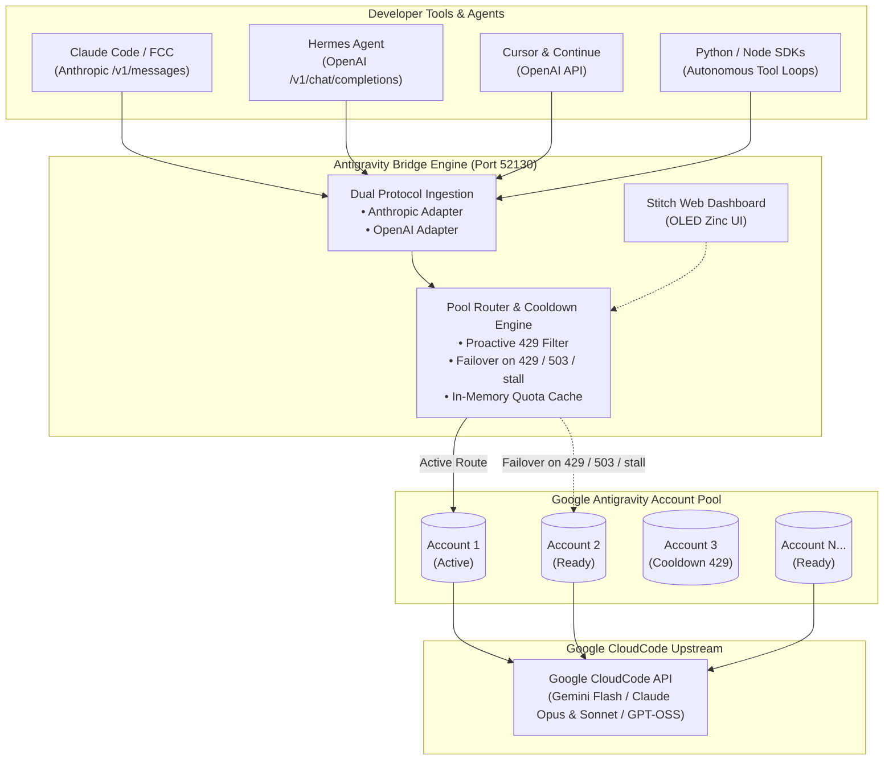

<div align="center">

# ⚡ Antigravity Bridge

### Universal Multi-Account AI Gateway & Proxy for Google Antigravity (CloudCode)

**Zero-downtime, auto-failover quota pool and dual-protocol gateway (Anthropic & OpenAI) for Claude Code, Hermes Agent, Cursor, Continue, and Custom Agentic Loops.**

[](https://opensource.org/licenses/ISC)
[](https://nodejs.org/)
[](https://docs.anthropic.com/)
[](https://stitch.withgoogle.com/)

[**Features**](#-features) • [**Quick Start**](#-quick-start) • [**Client Guides**](#-client-integration-guides) • [**Web Dashboard**](#-web-dashboard) • [**API Docs**](#-api-reference) • [**CLI Reference**](#-cli-commands)

---

</div>

## 📌 Overview

**Antigravity Bridge** transforms multiple personal or team Google accounts into a single, high-availability, unified AI inference endpoint. 

When developing with advanced coding agents like **Claude Code**, **Hermes**, or **Cursor**, hitting Google CloudCode's rate limits (`HTTP 429 RESOURCE_EXHAUSTED` / *"Individual quota reached"*) halts your momentum. Antigravity Bridge solves this by pooling multiple Google accounts and providing **automatic, transparent failover**. If your active account hits a rate limit, or Google has no capacity for the model on it, the bridge routes the request to the next available account in the pool before anything is streamed back, so your session and tool loop carry on.



---

## ✨ Features

- 🔄 **Unified Multi-Account Quota Pool**: Combine 2, 6, or 20+ Google accounts into a single virtual pool.
- ⚡ **Transparent Auto-Failover**: When an account reaches its quota limit (HTTP 429), the request is retried on the next available account and the exhausted one cools down until Google's reset time. A 503 "no capacity" rotates too, without a cooldown, since capacity is per project and not a quota signal. Failover happens before the response starts streaming; a failure after the first chunk reaches the client as an error event.
- ⏱ **Stall Rotation**: Google occasionally accepts a request and then never answers, in bursts of several minutes on one account. After `BRIDGE_UPSTREAM_TIMEOUT_MS` (60 s) the bridge moves on to another account instead of waiting inside the burst, and rests the stalled one for `BRIDGE_STALL_REST_SECONDS` (300 s). It is not a quota cooldown, so nothing is written to the quota file.
- 🌐 **Patient Connections**: each of Google's addresses gets `BRIDGE_CONNECT_ATTEMPT_TIMEOUT_MS` (2 s) to connect instead of Node's 250 ms, and a connection that fails quickly is retried after 2 s and then 5 s, so a few seconds of network trouble on the host no longer fail the request.
- ⏱️ **Dual Rolling Quota Telemetry**: Live extraction and monitoring of Google's internal **5-Hour Rolling Limit %** and **Weekly Cycle Cap %** per account.
- 🔌 **Dual-Protocol Translation**:
  - **Anthropic Messages API** (`/v1/messages`): Full streaming SSE, extended thinking blocks (`claude-opus-4-6-thinking`), and multi-turn tool calling.
  - **OpenAI Chat Completions** (`/v1/chat/completions`): Full streaming, `tool_calls` schemas, `reasoning_effort` mapping, and function execution.
- 🎨 **Google Stitch Web Dashboard**: High-craft web interface built to Google Stitch specifications (`DESIGN.md`) in **Minimalist OLED Zinc** dark mode, with smooth live countdown timers, activity streams, and an interactive theme switcher.
- 🔑 **Automated PKCE OAuth & Background Refresh**: One-click Google login via web browser. Tokens refresh automatically in the background before expiration.
- 🖥️ **macOS LaunchAgent Support**: Native background daemon running automatically on system startup.

---

## 🧠 Supported Models

Model ids are **Google's own ids, sent verbatim** — what you configure is exactly what runs. Every
figure below comes from Google's `fetchAvailableModels`; re-check it any time with
`npm run bridge:models`, which reports anything that has drifted.

| Model ID | Thinking budget | Context | Output | Best suited for |
| :--- | :--- | :--- | :--- | :--- |
| `claude-opus-4-6-thinking` | 1,024 | 250K | 64K | Complex refactors, deep reasoning |
| `claude-sonnet-4-6` | 1,024 | 250K | 64K | High-speed agentic coding, daily pair-programming |
| `gemini-3.8-flash-tiered` | dynamic | 1M | 65K | **Newest and most capable Gemini — pick low/medium/high per request** |
| `gemini-3-flash` | dynamic | 1M | 65K | General fast generation |
| `gemini-3.5-flash-lite` | off unless asked | 1M | 65K | Ultra-low latency |
| `gemini-3.1-flash-lite` | off unless asked | 1M | 65K | Ultra-low latency, older generation |
| `gpt-oss-120b-medium` | 8,192 | 131K | 32K | GPT-OSS 120B via Antigravity |

**"dynamic"** means the model sizes its own reasoning. The bridge forwards that rather than pinning
a number, since an explicit budget would switch it off.

**"off unless asked"**: the Flash Lites can reason but declare no default budget, and without one they
do not. The bridge sends them no thinking settings unless you ask for reasoning — an explicit budget,
or an effort level above the protocol's default (`reasoning_effort: "high"`, or Anthropic's
`xhigh` / `max`).

**There is no Gemini Pro.** Google stopped serving `gemini-pro-agent` and `gemini-3.1-pro-low`
(HTTP 404), and `gemini-2.5-pro` answers 503 "no capacity" on every account. Pro ids resolve to
`gemini-3.8-flash-tiered`, with a warning in the bridge log.

**Tiered vs. fixed tiers.** Antigravity's own model picker maps its "flash" option to
`gemini-3.8-flash-tiered` and lets you slide reasoning from low to high — the tier is a *request
parameter*, not part of the model name. Use `reasoning_effort` (or `thinking.budget_tokens`) to
choose it. Google used to offer fixed-tier ids too (`gemini-3.6-flash-high`, `gemini-3.5-flash-low`,
and so on), with the tier in the name. It no longer serves any of them, so those ids now resolve to
the tiered model at the tier their name fixed: `-low` thinks 1,000 tokens, `-medium` 4,000, and `-high`
stays dynamic, as before. `reasoning_effort` scales from there, and an explicit budget overrides it.
A reasoning suffix on a model name works the same way, on any Gemini id: `gemini-3-flash-low` is
`gemini-3-flash` at the low tier, and `gemini-3.8-flash-tiered-medium` is the tiered model at medium. The
bridge warns that the id is not exact and keeps both the model and the tier. Claude and GPT-OSS ignore
the suffix, because their reasoning budgets are fixed.

### Controlling reasoning

Each model carries its own default budget, so the same request reasons differently per model.

- **Anthropic API**: `thinking: { budget_tokens: N }` sets an exact figure, or
  `thinking: { type: "disabled" }` turns reasoning off. Otherwise `output_config.effort` — which
  Claude Code sends on every request — scales that model's default: `low` is a quarter of it,
  `medium` a half, `high` **is it**, `xhigh` double, `max` four times. In Claude Code that is
  `/effort`, or `effortLevel` in its settings.
- **OpenAI API**: `reasoning_effort` scales the same default — `low` is a quarter of it,
  `medium` **is it**, `high` is four times it. `reasoning_tokens: N` sets an exact figure.
- **Tiered models** (`gemini-3.8-flash-tiered` and friends) have no fixed default, so effort selects
  the tier instead on either API: `low` = 1,000, `medium` = 4,000, `high` and above = dynamic.

Each protocol's *default* level is the model's own default, deliberately: Claude Code sends
`high` even when nobody chose it, and OpenAI clients default to `medium`. Doing nothing therefore
changes nothing — lower levels save, higher levels spend.

An agent can ask for a single tool call whose argument is an entire file. Google sends a function
call only when it is complete, so one that the output cap cuts off never arrives: the turn ends
`max_tokens` with nothing in it, and some clients call that "empty output". If you cannot raise the
client's own limit, set `BRIDGE_TOOL_MIN_OUTPUT_TOKENS` (for example `65536`) and any request that
carries tools and sent a smaller cap is raised to it, up to the model's own limit. It is off by
default, because it overrides a cap the caller chose and a model that writes at length uses more
quota; requests without tools keep the cap they sent.

Thinking tokens count against `max_tokens`, so the bridge fits the budget inside whatever cap you
send and holds back 8,192 tokens for the visible answer. Tune that with
`BRIDGE_ANSWER_RESERVE_TOKENS` — lower it for more reasoning, raise it if long answers get
truncated. `npm run bridge:usage` reports the reasoning tokens actually consumed. OpenAI responses
count reasoning inside `completion_tokens` and itemise it in
`completion_tokens_details.reasoning_tokens`, as OpenAI does; for a stream, ask for it with
`stream_options: { include_usage: true }`. Anthropic responses count it inside `output_tokens`, as
Anthropic does, so the figure Claude Code shows is what the request really cost.

### Renamed ids

The previous table advertised models it did not deliver: `gemini-3-pro` pointed at a model Google
no longer serves, `gemini-3.1-pro` was pinned to the Low tier, and five separate flash ids all
resolved to the same `gemini-3-flash`. Those ids still resolve, now to the model they claimed to
be, but prefer the real ids above.

| Old id | Now resolves to |
| :--- | :--- |
| `gemini-3.1-pro`, `gemini-3-pro`, `gemini-3.1-pro-high`, `gemini-pro-agent`, `gemini-2.5-pro` | `gemini-3.8-flash-tiered` (no Pro is served) |
| `gemini-3.1-pro-low` | `gemini-3.8-flash-tiered`, 1,000-token reasoning |
| `gemini-3.8-flash`, `gemini-3.8-flash-high`, `gemini-3.7-flash`, `gemini-3.7-flash-high`, `gemini-3.7-flash-tiered`, `gemini-3.6-flash-tiered` | `gemini-3.8-flash-tiered` |
| `gemini-3.6-flash-high`, `gemini-3-flash-agent` | `gemini-3.8-flash-tiered`, dynamic reasoning |
| `gemini-3.6-flash-medium`, `gemini-3.5-flash-low` (Google's "Medium") | `gemini-3.8-flash-tiered`, 4,000-token reasoning |
| `gemini-3.6-flash-low`, `gemini-3.5-flash-extra-low` (Google's "Low") | `gemini-3.8-flash-tiered`, 1,000-token reasoning |
| `gemini-2.5-flash`, `gemini-2.5-flash-lite` | `gemini-3.5-flash-lite` |
| `gemini-2.5-flash-thinking` | `gemini-3.5-flash-lite`, dynamic reasoning |

Google's catalogue is not proof that a model is served: `npm run bridge:models` reads only the
catalogue, so it cannot tell. It kept listing `gemini-3.1-pro-high` while answering HTTP 400 to every
request for it. It still lists the three 3.5 Flash tiers, which answer HTTP 200 with a single canned
sentence ("Gemini 3.5 Flash is no longer available...") in place of a reply. It also lists the 2.5
Flash ids under the display name "Gemini 3.5 Flash Lite". The bridge points every one of these at a
model that answers, and warns once when it does.

---

## ⬆️ Upgrading from 1.x

**2.0 is breaking.** Three things can stop working — see [CHANGELOG.md](CHANGELOG.md) for the full
list and the reasoning.

1. **Set `BRIDGE_API_KEY`** if the bridge is reachable from anywhere but this machine, including
   behind a reverse proxy. Without it, remote requests are refused rather than served. Point your
   clients' `ANTHROPIC_API_KEY` / `OPENAI_API_KEY` at that value instead of `antigravity-local`.
2. **Update model ids.** Old ones still resolve and the bridge warns once per id, but several used
   to point somewhere other than their name suggested. `npm run bridge:models` shows what Google
   actually serves.
3. **Re-sync your clone.** `main` was rewritten to strip a hardcoded deployment address, so a plain
   `git pull` will conflict:

   ```bash
   git fetch origin && git reset --hard origin/main
   ```

---

## 🚀 Quick Start

### 1. Prerequisites
- **Node.js**: v18.18 or later (v20+ recommended). `start` sets Node's per-address connect timeout
  (`net.setDefaultAutoSelectFamilyAttemptTimeout`), which older 18.x releases do not have, so the
  bridge will not boot on them.
- **Package Manager**: `npm`, `pnpm`, or `bun`
- A Google account with access to Google Antigravity / CloudCode

### 2. Installation

Clone this repository and install dependencies:

```bash
# Clone the repository
git clone https://github.com/zakyirsyaad/antigravity-bridge.git
cd antigravity-bridge

# Install dependencies
npm install
```

### 3. Connect Your First Google Account

Run the interactive OAuth login:

```bash
npm run bridge:login
```
*A browser window will open. Sign in with your Google account. The OAuth tokens and project metadata will be securely stored in `~/.zcode/antigravity-accounts.json`.*

### 4. Add Additional Accounts to the Pool

You can add as many Google accounts as you want to expand your quota headroom:

```bash
# Run login again in a browser where you are signed in to your secondary account:
npm run bridge:login
```
*Or open the Web Dashboard and click **"+ Add Account"** in the top right.*

### 5. Start the Bridge Server

```bash
# Start standalone server
npm run bridge:start
```

The server listens on port **52130** (`PORT` changes it) on **every interface** (`0.0.0.0`), so other
machines on your network can reach it too. Set `BRIDGE_HOST=127.0.0.1` to keep it local, and read
[Security & Privacy](#-security--privacy) before exposing it. From this machine:
- 🌐 **Web Dashboard**: `http://127.0.0.1:52130/`
- 📨 **Anthropic API**: `http://127.0.0.1:52130/v1/messages`
- 🤖 **OpenAI API**: `http://127.0.0.1:52130/v1/chat/completions`
- 🩺 **Health Check**: `http://127.0.0.1:52130/health`

---

## 🔄 Updating

```bash
npm run bridge:update
```

That is the whole thing: it fast-forwards the checkout, installs dependencies, and — if the
LaunchAgent is installed — reloads the daemon so the running process is the code you just pulled.
It prints the version it left and the version it reached.

It refuses rather than guesses:

- **Uncommitted changes?** Nothing is pulled, and your work is never discarded. Commit or stash first.
- **Not a git checkout?** It says so instead of emitting a cryptic git error.
- **Diverged branch?** Only a fast-forward is accepted; the checkout is left untouched.

Stuck on `Local changes are present` with **only** `package-lock.json` listed? Releases 2.1.0 and
2.1.1 had a bug that left that file modified after every update — npm rewrote its `version` lines —
so the *next* update refused. The updater you are running cannot rescue itself, so once:

```bash
git checkout -- package-lock.json && npm run bridge:update
```

From 2.1.2 on it restores that file itself, but only when the version lines are the sole change.
Edit anything else in the lockfile and it stays yours and is still refused.

If you run the bridge some other way, restart it yourself after updating:

| How you run it | Restart |
|---|---|
| LaunchAgent (macOS) | handled by `bridge:update` |
| pm2 | `pm2 restart antigravity-bridge` — **not** with `--update-env`, which drops `BRIDGE_API_KEY` |
| Foreground | Ctrl+C, then `npm run bridge:start` |

Your accounts, quota and usage live in `~/.zcode/`, outside the repository, so updating never
touches them. `npm run bridge:status` also tells you when a newer release exists.

Read [CHANGELOG.md](CHANGELOG.md) before a major version jump.

---

## 🤖 Client Integration Guides

The examples below talk to a bridge on the same machine, which needs no key. For a bridge on another
host, such as a VPS behind a reverse proxy, change two things in every example:

- the base URL: `http://127.0.0.1:52130` becomes your bridge's address, e.g. `https://bridge.example.com`
  (keep the `/v1` suffix where an example has one);
- the key: `antigravity-local` becomes that bridge's `BRIDGE_API_KEY`. Without it every request is
  answered `401`.

The dashboard's setup guide fills in both for the host you open it on.

### 1. Claude Code & Free Claude Code (FCC)

Configure official **Claude Code** or community runners to point to the local Anthropic endpoint:

```bash
export ANTHROPIC_BASE_URL="http://127.0.0.1:52130"
export ANTHROPIC_API_KEY="antigravity-local"

# Start Claude Code
claude
```

If using `fcc` (Free Claude Code):
```bash
export ANTHROPIC_BASE_URL="http://127.0.0.1:52130"
fcc
```

---

### 2. Hermes Autonomous Agent

Hermes Agent connects via the OpenAI compatible endpoint. Add the provider to `~/.hermes/config.yaml`:

```yaml
providers:
  antigravity:
    base_url: "http://127.0.0.1:52130/v1"
    api_key: "antigravity-local"
```

Run Hermes with Gemini 3.8 Flash (Tiered):
```bash
# One-shot command execution
hermes --provider antigravity -m gemini-3.8-flash-tiered -z "Check workspace files and run unit tests"

# Interactive TUI mode
hermes --provider antigravity -m gemini-3.8-flash-tiered --tui
```

---

### 3. Cursor IDE & Continue.dev

In **Cursor** (`Settings > Models > OpenAI`):
1. **OpenAI API Key**: `antigravity-local`
2. **Override OpenAI Base URL**: `http://127.0.0.1:52130/v1`
3. Add model names: `gemini-3.8-flash-tiered`, `claude-opus-4-6-thinking`, `gemini-3.5-flash-lite`

In **Continue.dev** (`~/.continue/config.json`):
```json
{
  "models": [
    {
      "title": "Gemini 3.8 Flash Tiered (Antigravity)",
      "provider": "openai",
      "model": "gemini-3.8-flash-tiered",
      "apiBase": "http://127.0.0.1:52130/v1",
      "apiKey": "antigravity-local"
    }
  ]
}
```

---

### 4. Python OpenAI SDK (Tool Execution & Reasoning)

Standard OpenAI Python SDK scripts work out of the box with function calling and multi-turn tool loops:

```python
from openai import OpenAI

client = OpenAI(
    base_url="http://127.0.0.1:52130/v1",
    api_key="antigravity-local"
)

response = client.chat.completions.create(
    model="gemini-3.8-flash-tiered",
    messages=[
        {"role": "system", "content": "You are an expert autonomous assistant."},
        {"role": "user", "content": "What is the capital of Indonesia?"}
    ],
    extra_body={"reasoning_effort": "high"}
)

print(response.choices[0].message.content)
```

---

### 5. cURL Direct Request

#### OpenAI Chat Completion:
```bash
curl -s -X POST http://127.0.0.1:52130/v1/chat/completions \
  -H "Content-Type: application/json" \
  -H "Authorization: Bearer antigravity-local" \
  -d '{
    "model": "gemini-3.8-flash-tiered",
    "messages": [{"role": "user", "content": "Hello!"}]
  }'
```

#### Anthropic Messages:
```bash
curl -s -X POST http://127.0.0.1:52130/v1/messages \
  -H "Content-Type: application/json" \
  -H "x-api-key: antigravity-local" \
  -H "anthropic-version: 2023-06-01" \
  -d '{
    "model": "claude-sonnet-4-6",
    "max_tokens": 100,
    "messages": [{"role": "user", "content": "Hello from Anthropic protocol!"}]
  }'
```

---

## 🎨 Web Dashboard

Open **`http://127.0.0.1:52130`** in your browser to access the management interface:

- **OLED Zinc Aesthetics**: Pitch-black canvas (`#000000`) with high-contrast chrome elements and concentric card radii following the **Google Stitch Design System** (`DESIGN.md`).
- **Live Account Grid**:
  - `● Active`: Currently handling primary traffic.
  - `○ Ready`: Standing by for failover or manual switch.
  - `⏳ Cooling Down`: Rate-limited by Google (HTTP 429) with live ticking countdown timer (*"Resets in 1h 14m 20s"*).
  - `◌ Resting`: Google stopped answering on this account, so failover skips it for a few minutes (`BRIDGE_STALL_REST_SECONDS`). Held in memory, not a quota cooldown.
- **Activity Stream**: every failover says why it happened (429 quota, 503 no capacity, 503 service unavailable, stall, cooling down, resting) and for which model.
- **Dual Live Quotas**: Real-time bars showing internal 5-hour rolling limit and weekly cycle cap percentages.
- **One-Click Actions**:
  - **Set Active**: Manually route traffic to a specific account.
  - **Clear Cooldown**: Reset the rate limit timer on an account.
  - **Delete**: Remove an account from storage.
  - **Auto-Failover Toggle**: Enable/disable automatic switching.
- **Interactive Theme Switcher**: Choose between **OLED Zinc** (Default), **Gemini Cosmic**, **Claude Studio**, or **Cyber Emerald**.

---

## 📡 API Reference

### Management Endpoints

| Method | Endpoint | Description |
| :--- | :--- | :--- |
| `GET` | `/health` | Service status, current active account, and supported models list |
| `GET` | `/api/pool` | Complete pool state, all accounts with live quota telemetry, and recent events |
| `POST` | `/api/pool/switch` | Switch active account (`{"email": "user@gmail.com"}`) |
| `POST` | `/api/pool/toggle` | Toggle auto-failover engine ON/OFF |
| `POST` | `/api/pool/clear-cooldown` | Manually clear cooldown on an account (`{"email": "user@gmail.com"}`) |
| `POST` | `/api/pool/delete` | Remove an account from the pool (`{"email": "user@gmail.com"}`) |
| `GET` | `/api/pool/auth-url` | Generate Google OAuth PKCE authorization URL for browser login |

### Inference Endpoints

| Method | Endpoint | Compatible Client |
| :--- | :--- | :--- |
| `POST` | `/v1/messages` | Anthropic Claude Code, Free Claude Code, Anthropic Python/Node SDK |
| `POST` | `/v1/chat/completions` | Hermes Agent, Cursor, Continue.dev, OpenAI Python/Node SDK |
| `GET` | `/v1/models` (also `/models`) | Any OpenAI-compatible client. Lists the exposed models, each with `context_length`, which clients use to size their prompts |

### Error responses

Errors carry `error.type` and `error.message`. A `400` or `503` from Google's side also carries the
top-level `type: "error"` that the Anthropic SDKs expect. The message says which of these happened:

| Status | `error.type` | What happened | What to do |
| :--- | :--- | :--- | :--- |
| `400` | `invalid_request_error` | Google rejected the request itself (a tool schema or parameter it cannot take), or the model id matches nothing. Google's own message is kept | Fix the request; retrying will not help |
| `401` | `unauthorized` | A non-loopback caller sent no key or the wrong one, or the bridge has no `BRIDGE_API_KEY` set at all | Send the key, or set one on the bridge |
| `403` | `forbidden` | A web page on another origin called the management API | Use the dashboard on the bridge's own host |
| `503` | `overloaded_error` | Google has no capacity for the model on every account tried. Not quota: nothing cools down | Retry shortly, or use another model |
| `503` | `api_error` | Google answered some other 503 (an outage) on every account tried | Retry shortly |
| `500` | `server_error` / `api_error` | Every account is cooling down after a 429 (*"All accounts in the pool are currently rate limited"*), Google stopped answering (*"Google stopped answering requests for model …"*), or anything else | Read the message: only the first one is quota |

Two exceptions, both from how streaming works:

- On `/v1/chat/completions` with `stream: true`, only a `400` or `503` is sent as a real status. Every
  other failure before the first chunk comes back as HTTP `200` with a `data: {"error": …}` event, so a
  `200` on that route does not by itself mean success.
- Once a stream has started, a failure on either route can only be an in-band error event.

---

## 🛠️ CLI Commands

Antigravity Bridge provides a set of CLI shortcuts:

```bash
# Server
npm run bridge:start             # Start the bridge in the foreground
npm run bridge:update            # Fast-forward to the latest release and install dependencies (see Updating)

# Account & Pool Management
npm run bridge:accounts          # List all saved Google accounts and active status
npm run bridge:switch <id/email> # Switch the active account by index or email address
npm run bridge:login             # Launch interactive browser login for a new account
npm run bridge:status            # Check token validity and connection status, and whether a newer release exists
npm run bridge:usage             # View request count, token usage, and reasoning tokens consumed
npm run bridge:models            # Check the model table against what Google actually serves
npm run bridge:sync              # Rewrite ZCode's provider config from the model table (also runs on start and login)

# macOS Background Service (LaunchAgent)
npm run bridge:service:install   # Install & start background launchd daemon (auto-start on boot)
npm run bridge:service:uninstall # Stop & remove the background launchd service

# Verification
npm run test:<name>              # Offline suites (stream, security, models, capacity, stall, ...): no account, network or quota
npm test                         # Live end-to-end suite: sends real requests to Google, needs a logged-in account and uses quota
```

The offline suites are listed in `package.json`. `npm test` (also `npm run test:bridge`) is the only
one that talks to Google; run it when you need proof that the models it uses are actually served.

---

## ⚙️ macOS Background Daemon (LaunchAgent)

To run Antigravity Bridge continuously in the background on macOS without keeping a terminal open:

```bash
npm run bridge:service:install
```

- Plist Configuration: `~/Library/LaunchAgents/com.antigravity.zcode-bridge.plist`
- Standard Logs: `~/.zcode/logs/antigravity-bridge.log`
- Error Logs: `~/.zcode/logs/antigravity-bridge.err.log`

To restart or inspect the service:
```bash
# Restart service
launchctl kickstart -k gui/$(id -u)/com.antigravity.zcode-bridge

# View live logs
tail -f ~/.zcode/logs/antigravity-bridge.log
```

---

## 🧩 Configuration

Every setting is an environment variable read when the bridge starts. Nothing needs setting for a
local install.

| Variable | Default | Effect |
| :--- | :--- | :--- |
| `PORT` | `52130` | Port the server listens on |
| `BRIDGE_HOST` | `0.0.0.0` | Interface to bind. `127.0.0.1` keeps the bridge on this machine |
| `BRIDGE_API_KEY` | *(none)* | Shared secret that non-loopback callers must send. Without it they are refused |
| `BRIDGE_TRUST_LOCAL` | trusted | `0` requires the key from loopback callers too |
| `BRIDGE_UPSTREAM_TIMEOUT_MS` | `60000` | How long to wait for Google's first response before treating it as a stall |
| `BRIDGE_STALL_REST_SECONDS` | `300` | How long a stalled account is skipped (in memory only, not a quota cooldown) |
| `BRIDGE_CONNECT_ATTEMPT_TIMEOUT_MS` | `2000` | Time each of Google's addresses gets to connect |
| `BRIDGE_ANSWER_RESERVE_TOKENS` | `8192` | Output tokens held back from thinking for the visible answer |
| `BRIDGE_TOOL_MIN_OUTPUT_TOKENS` | off | Raises a smaller output cap on requests that carry tools (see [Controlling reasoning](#controlling-reasoning)) |
| `ANTIGRAVITY_CLIENT_ID` / `ANTIGRAVITY_CLIENT_SECRET` | Antigravity desktop app's | OAuth client used for login and token refresh |

Under pm2, set these when the process is first started (or with `pm2 restart --update-env` from a
shell that has *all* of them, then `pm2 save`). A plain `pm2 restart` keeps the environment it has.

---

## 🔒 Security & Privacy

- **Bind address**: the server listens on `0.0.0.0` by default, so it is reachable from your network. Set `BRIDGE_HOST=127.0.0.1` to restrict it to this machine.
- **Authentication**: requests over loopback are trusted, so a local install needs no configuration. Anything else must present a shared secret:

  ```bash
  export BRIDGE_API_KEY="$(openssl rand -hex 32)"   # on the machine running the bridge
  npm run bridge:start
  ```

  Remote clients send it as `Authorization: Bearer <key>` or `x-api-key: <key>` — the same headers they already use for an API key, so point `ANTHROPIC_API_KEY` / `OPENAI_API_KEY` at it instead of `antigravity-local`. The web dashboard prompts for the key once and remembers it in that browser.

  **If you expose this bridge beyond your own machine, set `BRIDGE_API_KEY`.** Without it, remote requests are refused rather than served — the endpoints hand out pooled Google quota and can delete accounts from the pool, so an unauthenticated public deployment is not a supported configuration. Set `BRIDGE_TRUST_LOCAL=0` to require the key on loopback too.
- **Local Credential Storage**: All OAuth access tokens and refresh tokens are stored locally in `~/.zcode/antigravity-accounts.json` with user-level read permissions.
- **No Third-Party Intermediaries**: Requests flow directly between your machine and Google's official CloudCode servers. No telemetry, prompts, or code are sent to any external server.

---

## 📄 License

This project is licensed under the [ISC License](LICENSE).
